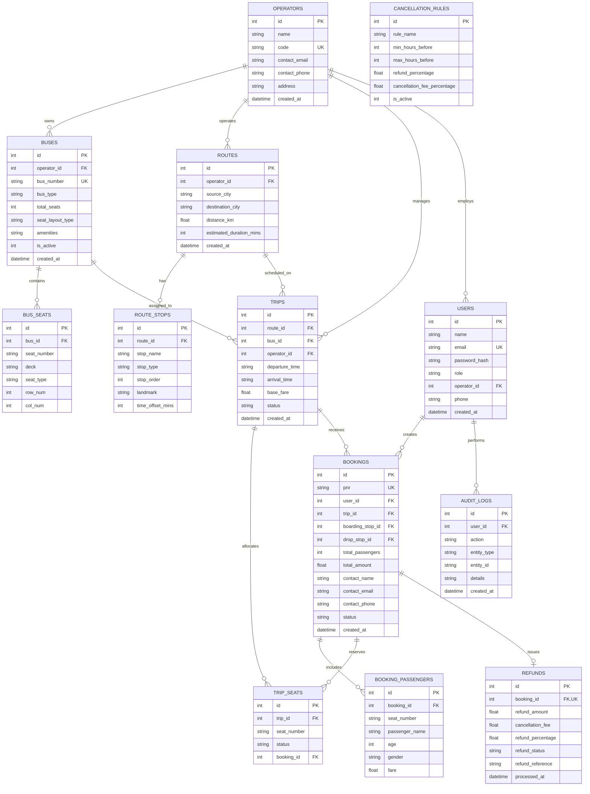

# Entity-Relationship (ER) Diagram & Schema Specification

## 1. Overview
The **Bus Booking Management System** uses a normalized relational schema designed for SQLite (with foreign keys and WAL mode enabled). The schema ensures:
1. **Referential Integrity**: Cascading and restrictive foreign key relations.
2. **Seat Integrity**: Physical seat coordinate templates (`bus_seats`) mapped dynamically to scheduled trip seat inventories (`trip_seats`) with strict unique constraints (`UNIQUE(trip_id, seat_number)`).
3. **Auditability & History Preservation**: Booking history and passenger manifests are preserved even when bookings are cancelled.
4. **Configurable Policies**: Time-tiered cancellation rules calculated on demand.

---

## 2. Mermaid Entity-Relationship Diagram

---

## 3. Data Dictionary & Table Definitions

### 1. `users`
Stores user accounts for authentication and role-based access control.
- `id` (INTEGER, PK, AUTOINCREMENT)
- `name` (TEXT, NOT NULL)
- `email` (TEXT, NOT NULL, UNIQUE)
- `password_hash` (TEXT, NOT NULL) - Bcrypt hash
- `role` (TEXT, CHECK: `CUSTOMER`, `OPERATOR`, `ADMIN`)
- `operator_id` (INTEGER, NULL, FK -> `operators.id`)
- `phone` (TEXT)
- `created_at` (DATETIME, DEFAULT CURRENT_TIMESTAMP)

### 2. `operators`
Bus transport agencies operating routes and vehicles.
- `id` (INTEGER, PK, AUTOINCREMENT)
- `name` (TEXT, NOT NULL)
- `code` (TEXT, NOT NULL, UNIQUE) - e.g. `ROYLT`, `CTEXP`
- `contact_email` (TEXT, NOT NULL)
- `contact_phone` (TEXT, NOT NULL)
- `address` (TEXT)
- `created_at` (DATETIME)

### 3. `buses`
Vehicles in fleet inventory with seating capacity and amenities.
- `id` (INTEGER, PK, AUTOINCREMENT)
- `operator_id` (INTEGER, FK -> `operators.id`)
- `bus_number` (TEXT, NOT NULL, UNIQUE)
- `bus_type` (TEXT, NOT NULL) - e.g., 'AC Seater 2+2', 'AC Sleeper 2+1'
- `total_seats` (INTEGER, NOT NULL)
- `seat_layout_type` (TEXT) - `SEATER_2X2` or `SLEEPER_2X1`
- `amenities` (TEXT) - JSON array of amenities (WiFi, Charging, etc.)
- `is_active` (INTEGER, DEFAULT 1)

### 4. `bus_seats`
Template seats representing physical geometry in the bus cabin.
- `id` (INTEGER, PK)
- `bus_id` (INTEGER, FK -> `buses.id`)
- `seat_number` (TEXT) - e.g., '1A', 'L1A'
- `deck` (TEXT, DEFAULT 'LOWER')
- `seat_type` (TEXT, DEFAULT 'SEATER')
- `row_num` (INTEGER)
- `col_num` (INTEGER)
- `UNIQUE(bus_id, seat_number)`

### 5. `routes` & `route_stops`
Geographic transit corridors and designated boarding/dropping points.
- `routes`: `id`, `operator_id`, `source_city`, `destination_city`, `distance_km`, `estimated_duration_mins`.
- `route_stops`: `id`, `route_id`, `stop_name`, `stop_type` (`BOARDING` / `DROPPING`), `stop_order`, `landmark`, `time_offset_mins`.

### 6. `trips` & `trip_seats`
Concrete scheduled runs and real-time seat inventory.
- `trips`: `id`, `route_id`, `bus_id`, `operator_id`, `departure_time`, `arrival_time`, `base_fare`, `status` (`SCHEDULED`, `ACTIVE`, `COMPLETED`, `CANCELLED`).
- `trip_seats`: `id`, `trip_id`, `seat_number`, `status` (`AVAILABLE`, `BOOKED`), `booking_id`.
- **Constraint**: `UNIQUE(trip_id, seat_number)` prevents duplicate seat records per trip.

### 7. `bookings` & `booking_passengers`
Ticket reservations and passenger manifest entries.
- `bookings`: `id`, `pnr` (UNIQUE), `user_id`, `trip_id`, `boarding_stop_id`, `drop_stop_id`, `total_passengers`, `total_amount`, `contact_name`, `contact_email`, `contact_phone`, `status` (`CONFIRMED`, `CANCELLED`).
- `booking_passengers`: `id`, `booking_id`, `seat_number`, `passenger_name`, `age`, `gender`, `fare`.

### 8. `cancellation_rules` & `refunds`
Policy configuration and simulated financial refunds.
- `cancellation_rules`: `id`, `rule_name`, `min_hours_before`, `max_hours_before`, `refund_percentage`, `cancellation_fee_percentage`, `is_active`.
- `refunds`: `id`, `booking_id` (UNIQUE), `refund_amount`, `cancellation_fee`, `refund_percentage`, `refund_status`, `refund_reference`, `processed_at`.

### 9. `audit_logs`
Immutable record of material business actions.
- `id` (INTEGER, PK)
- `user_id` (INTEGER, FK -> `users.id`)
- `action` (TEXT) - e.g. `BOOKING_CREATED`, `BOOKING_CANCELLED`, `TRIP_SCHEDULED`
- `entity_type` (TEXT)
- `entity_id` (TEXT)
- `details` (TEXT / JSON)
- `created_at` (DATETIME)
